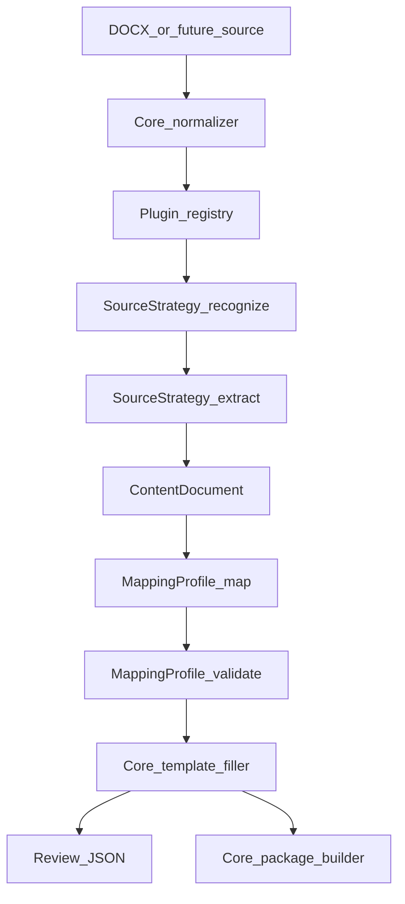

# Plan: Adaptation plugin platform

> **Status:** Planned. Not implemented.

Blueprint Studio gets a plugin system, similar in spirit to WordPress plugins. Core keeps everything that is the same for every job. Plugins hold the part that changes from one client document family to the next: how to read meaning out of a source and how to place that meaning into a target template.

## Why we are doing this

Every client sends documents in their own structure. Today, the USB publishing form (Headline and `*H1` tables, Element/Content body tables) is handled by [UsbTableFormRecipe](../../src/main/java/com/aem/bulkauthoring/docadapt/recipe/UsbTableFormRecipe.java), and normal Word articles by [WordOutlineRecipe](../../src/main/java/com/aem/bulkauthoring/docadapt/recipe/WordOutlineRecipe.java). Both are compiled into core and hardcoded in [SourceRecipeDetector](../../src/main/java/com/aem/bulkauthoring/docadapt/recipe/SourceRecipeDetector.java):

```java
this(List.of(new UsbTableFormRecipe(), new WordOutlineRecipe()));
```

So every new source family means editing core, rebuilding Studio, and risking existing flows. Teammates cannot build a new adapter on their own and hand it over.

The goal of automation is accuracy: authors should make as few manual corrections as possible after adapt. That accuracy comes from rules written for one specific document family. Those rules belong in a strategy that can be developed, tested, shared, and replaced on its own, without touching the rest of the application.

## What we want

These are the requirements this plan is built around.

1. **Core is deterministic and shared.** Anything that does not depend on the meaning of a client's content is core: reading DOCX (text, formatting, tables, hyperlinks, lists, images), discovering template markers, filling templates, writing review files, building AEM JSON, building and installing FileVault packages, and loading plugins.
2. **Plugins are adaptation and mapping strategies.** A plugin decides what a source document means and where each piece goes in the template. That is the only non-deterministic part of the system.
3. **The source shape follows the document.** We receive documents and describe their structure in a plugin. We do not ask clients to change their documents to fit our tool.
4. **One convention for all plugins.** Every plugin has the same layout, the same entry point, and the same contract. Like WordPress `functions.php` with a fixed set of hooks, a plugin only talks to core through a published API.
5. **No core edits to add a plugin.** Adding, sharing, or removing a plugin never changes core Java, core registries, or the root build.
6. **Develop in place or share as a ZIP.** I can develop a plugin inside my own Studio checkout. A teammate can do the same in theirs, then send me a ZIP. I install it, restart Studio, and it works the same way.
7. **Reusable extraction, separate mapping profiles.** One extractor for a source family can serve several target templates through separate mapping profiles. The usual case is still one source with one template.
8. **Written by people or AI agents.** A plugin can be hand-written or produced by an AI agent. Both follow the same authoring guide, examples, and tests.
9. **Future sources.** DOCX is first. Websites, HTML, PDF, and other inputs should fit the same model later, with core doing the fetching and parsing and the plugin doing the interpretation.

### Decisions already made

- **Internal use only.** Plugins are trusted team code. No sandboxing or signing.
- **Restart to apply.** Installing, updating, or removing a plugin takes effect after a Studio restart. No hot unload in version 1.
- **Small custom loader.** No plugin framework such as PF4J for now. A startup scan of plugin folders is enough.
- **Reusable extraction plus multiple mapping profiles**, as above.

## What "accurate" means

Full accuracy for every possible document or website is not achievable, because no fixed rules can understand arbitrary input. The guarantee this design gives is narrower and more useful:

> For a document that matches a plugin's declared source shape, extraction and mapping are deterministic. When a document does not match, Studio reports exactly what is missing or ambiguous, and does not silently write wrong content.

Every marker value carries evidence and a status:

```text
Marker:   /jcr:content/jcr:title
Value:    USB Online Banking
Source:   Headline table, row "*H1", column 2
Status:   EXACT
```

Statuses:

- `EXACT`: a rule matched exactly
- `INFERRED`: a fallback rule was used; review recommended
- `MISSING`: required content was not found
- `CONFLICT`: more than one candidate value
- `INVALID`: the value breaks a target rule, such as a length limit

`MISSING`, `CONFLICT`, and `INVALID` on a required marker block the template fill. The review JSON is still written so a person can see why.

## Core and plugin boundary



Core owns the mechanical steps, and the output is the same for any client:

- `SourceDocumentNormalizer`: DOCX into paragraphs, tables, cells, formatting, links
- Marker discovery and `SlotCatalog`
- `TemplateSlotFiller`
- Review JSON, AEM JSON, FileVault package, install
- Plugin loading, registry, error handling, logging

Plugins own interpretation:

- **Recognize:** is this document my shape, and why
- **Extract:** what the title, sections, headings, paragraphs, lists, links, and images are; what to ignore
- **Map:** which extracted content goes under which template marker; precedence and fallbacks
- **Validate:** what must be present and correct before the template is filled

An extractor must not mention any template. That is what makes it reusable across mapping profiles.

## Public contract

A new Maven module, `plugin-api`, is the only thing plugins compile against. Studio internals are off-limits to plugins.

It contains:

- Document model: [NormalizedDocument](../../src/main/java/com/aem/bulkauthoring/docadapt/model/NormalizedDocument.java), its block types, and [FormattedText](../../src/main/java/com/aem/bulkauthoring/docadapt/model/FormattedText.java)
- Canonical content: [ContentDocument](../../src/main/java/com/aem/bulkauthoring/docadapt/content/ContentDocument.java) and [ContentUnit](../../src/main/java/com/aem/bulkauthoring/docadapt/content/ContentUnit.java)
- Template view: slot catalog paths and roles, as used today by [BindingEngine](../../src/main/java/com/aem/bulkauthoring/docadapt/bind/BindingEngine.java)
- Plugin types: `AdaptationPlugin`, `PluginContext`, `SourceStrategy`, `MappingProfile`, `MatchResult`, `MappingResult`, `ValidationResult`

Entry point, the equivalent of `functions.php`:

```java
public final class UsbContentHubPlugin implements AdaptationPlugin {

    @Override
    public void activate(PluginContext ctx) {
        ctx.sourceStrategies().register(new UsbTableFormStrategy());
        ctx.mappingProfiles().register(new UsbToNormalPageProfile());
        ctx.mappingProfiles().register(new UsbToBbUsbProfile());
    }
}
```

`SourceStrategy` replaces today's `SourceRecipe`:

```java
public interface SourceStrategy {
    String id();
    MatchResult recognize(NormalizedDocument doc);   // score plus reason
    ContentDocument extract(NormalizedDocument doc); // no template knowledge
}
```

`MappingProfile` is separate:

```java
public interface MappingProfile {
    String id();
    String sourceStrategyId();
    String targetTemplateId();
    MappingResult map(ContentDocument content, SlotCatalog catalog);   // values, evidence, status
    ValidationResult validate(ContentDocument content, MappingResult mapped);
}
```

Mapping can be written two ways:

- **JSON** for simple cases. Core wraps a JSON mapping file as a `MappingProfile` that uses the existing binding engine.
- **Java** when marker rules need logic JSON cannot express.

Both register through `PluginContext` and look the same to [DocAdaptService](../../src/main/java/com/aem/bulkauthoring/docadapt/DocAdaptService.java).

Files saved by authors in [input/source-mappings](../../input/source-mappings) stay as overrides. They name a `sourceStrategy` and a `targetTemplate`. They never contain extractor code.

### API stability rule

The `plugin-api` version is `1`. Inside version 1, changes are additive only: new methods with defaults, new types, new optional fields. Removing or changing a published type means version 2. This is what lets many plugins keep working as core evolves.

## Plugin layout and loading

Studio scans three folders at startup:

- `plugins/bundled/<id>/`: strategies that ship with Studio
- `plugins-dev/<id>/`: plugins being developed inside this checkout
- `plugins/installed/<id>/`: ZIPs from teammates, unpacked

Each plugin folder:

```text
usb-content-hub/
├── plugin.json
├── pom.xml                 (depends on plugin-api with provided scope)
├── src/main/java/...
├── src/test/java/...
├── src/test/resources/     (sample source docs and expected output)
├── assets/                 (optional: templates, mapping JSON, profiles)
└── target/usb-content-hub.jar
```

`plugin.json`:

```json
{
  "id": "usb-content-hub",
  "name": "USB content hub publishing form",
  "version": "1.0.0",
  "apiVersion": "1",
  "main": "com.client.usb.UsbContentHubPlugin"
}
```

Loader rules:

1. Read `plugin.json` and load the jar in its own `URLClassLoader`, with the Studio class loader as parent.
2. Call `activate(PluginContext)`.
3. Record which strategy and mapping ids each plugin registered.
4. Skip the plugin and log the reason when `apiVersion` is not supported, the id is a duplicate, or `activate` throws. Studio still starts.
5. A plugin is active when its folder is present. To remove it, delete the folder and restart.

`SourceRecipeDetector` becomes a registry filled only through `activate()`. Core no longer names any plugin class.

The root `pom.xml` lists `plugin-api`, the Studio app, and the bundled plugins. A new plugin in `plugins-dev` is not added to the root build:

```bash
mvn -f plugins-dev/my-plugin package
# restart Studio
```

To share it, zip the plugin folder (at least `plugin.json` and the jar). The receiver unpacks it into `plugins/installed/` and restarts.

## Pipeline changes

In `DocAdaptService.run`, after the normalizer:

1. **Pick the mapping profile.** Use the explicit id, or the single profile matching the detected strategy and chosen template.
2. **Recognize.** With strategy set to `auto`, every strategy scores the document. The highest score above a minimum threshold wins. A tie stops the run with a conflict instead of guessing.
3. **Extract** with that strategy into `ContentDocument`.
4. **Map** with the selected profile into marker values with evidence and status.
5. **Validate.** Required-marker failures are blocking.
6. **Fill** the template only when nothing blocks. Always write review JSON.

[StudioApi](../../src/main/java/com/aem/bulkauthoring/studio/StudioApi.java) currently returns recipe ids for the Adapt screen. It also returns mapping profiles (`id`, strategy id, template id) and plugin load errors, so the UI can show what is installed and why something was skipped.

Package building stays as it is.

## First plugins

Moving the two existing recipes out of core is the proof that the boundary is right.

- `plugins/bundled/usb-content-hub`
  - `UsbTableFormStrategy`: extraction from `UsbTableFormRecipe`
  - `usb-to-normal-page` mapping profile: [normal-page.docx](../../input/templates/normal-page.docx), the title and body markers now in [usb-content-hub-normal-page.json](../../input/source-mappings/usb-content-hub-normal-page.json)
  - a second profile for the BB USB blueprint template: same extractor, different markers
- `plugins/bundled/word-outline`
  - `WordOutlineStrategy` plus one mapping profile

Existing recipe tests move with each plugin. Core tests use a fake strategy so core does not depend on any real plugin.

The legacy `slots[]` extract rules in [SourceMapping](../../src/main/java/com/aem/bulkauthoring/docadapt/mapping/SourceMapping.java) stay readable for one release. New plugins do not use them.

## Authoring guide

Add `docs/plugin-authoring.md` and link it from [docs/README.md](../README.md). People and AI agents both follow this document, so it needs exact paths, interfaces, and commands:

- folder layout, `plugin.json` fields, `provided` dependency on `plugin-api`
- the `recognize`, `extract`, `map`, `validate` contracts, and the rule that extract never mentions a template
- writing JSON mappings vs Java mappings
- registering several mapping profiles for one strategy
- statuses, evidence, and which failures block
- test fixtures: sample source in, expected `ContentDocument` and marker map out
- commands to build, install, restart, and run the plugin's tests
- ZIP sharing into `plugins/installed`
- API version 1 compatibility rule
- a minimal starter plugin, with the USB plugin as the full reference

## Future sources

`SourceStrategy` takes a normalized document, not a raw file. When website or PDF support is added, a new core reader produces the normalized model for that input, and plugins interpret it the same way. Core handles fetching URLs and parsing HTML. A plugin decides which part of a page is the title or body.

## Out of scope for version 1

- Activating or unloading plugins without a restart
- Website, HTML, and PDF readers
- A visual rule editor
- Plugin signing or sandboxing

## Tasks

1. Add the `plugin-api` module and move the document, content, slot, and plugin contract types into it.
2. Add the startup loader for `plugins/bundled`, `plugins-dev`, and `plugins/installed`, with one class loader per plugin and load errors reported to Studio.
3. Change `DocAdaptService` to recognize, extract, map, and validate; block template fill on blocking validation results; return profiles and plugin errors from Studio API.
4. Move USB table-form and Word outline into bundled plugins, with the USB extractor serving two mapping profiles.
5. Write `docs/plugin-authoring.md` with a starter plugin, ZIP layout, and test fixtures.
